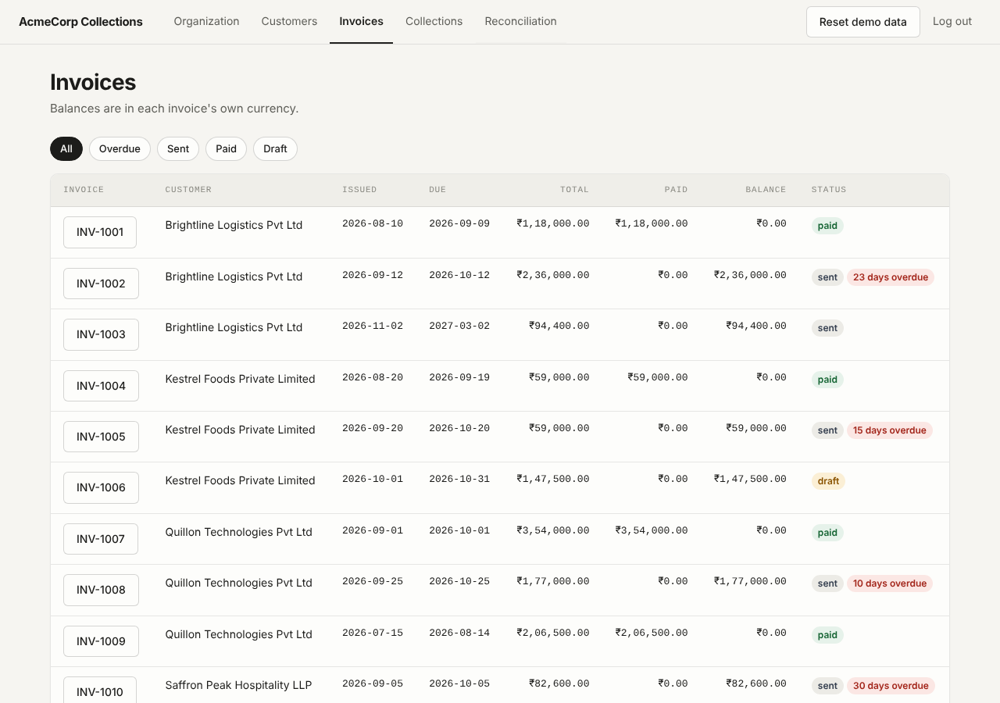
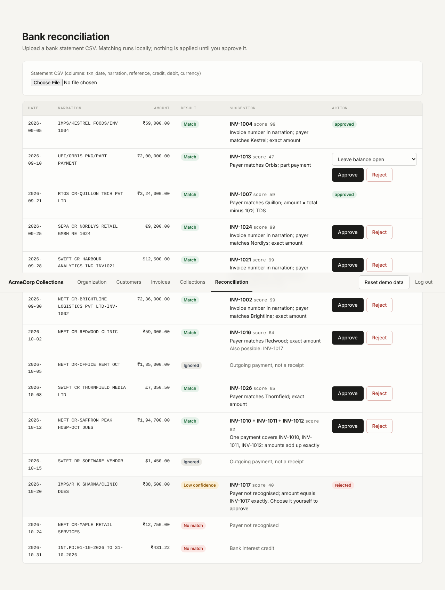
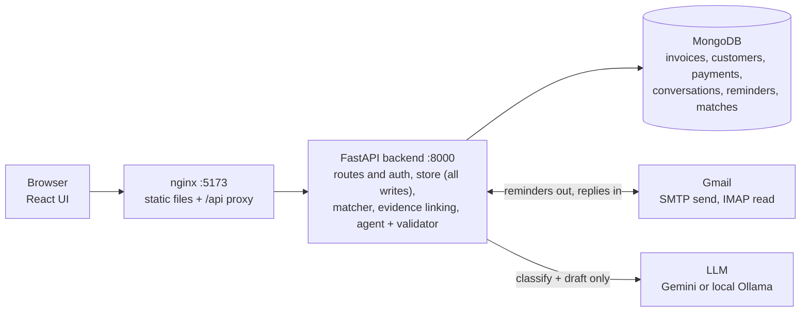
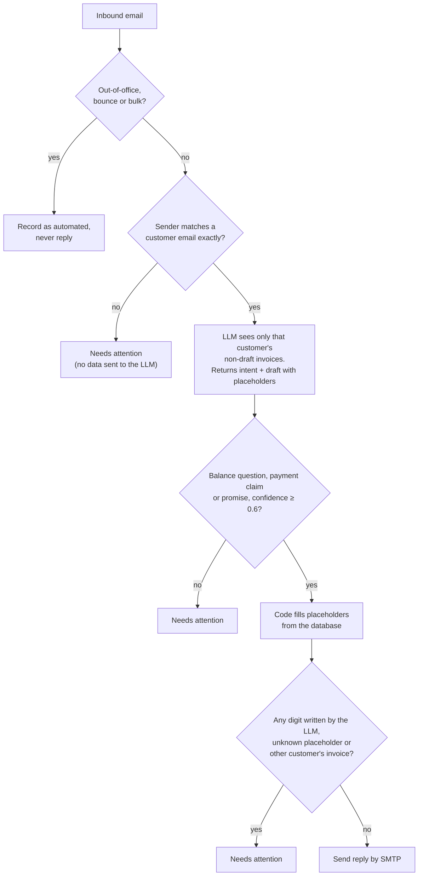
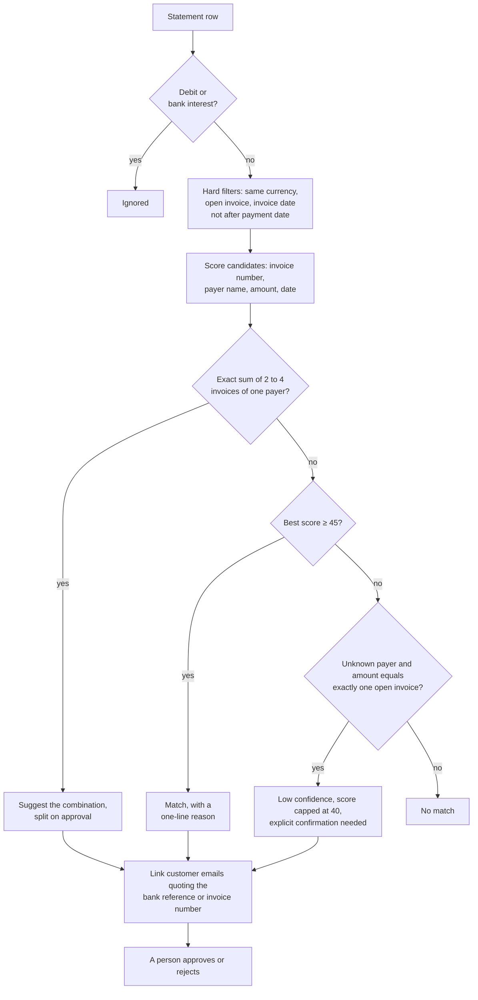
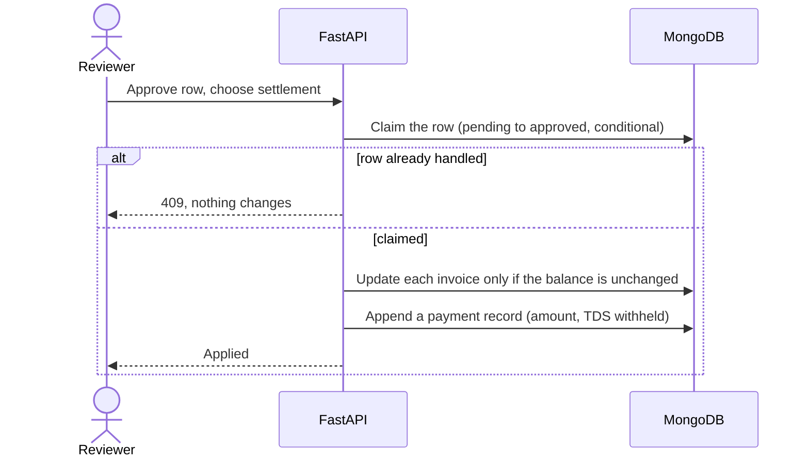

# AcmeCorp Collections and Reconciliation


An accounts-receivable assistant for the fictional company AcmeCorp. It emails customers about overdue invoices,
reads and answers their replies, and matches bank statements to open invoices. **A person approves every payment.
The LLM never decides, or even writes, a figure.**

> Built with AI assistance (Claude and Antigravity). I ran everything and can explain every part of it.

**Contents:** [What it does](#what-it-does) · [Architecture](#architecture) · [Run it](#run-it-end-to-end) ·
[Try it](#try-it-a-5-minute-walkthrough) · [How it works](#how-it-works) · [Tests and eval](#tests-ci-and-evaluation) ·
[Layout](#project-layout) · [API](#api-summary) · [Limits](#scope-and-honest-limits)

| Invoices | Bank reconciliation |
|---|---|
|  |  |

## What it does

| Area | Behaviour |
|---|---|
| **Invoices** | Seeded from the provided data. Overdue = status `sent`, balance above zero, due date before today. Drafts are never chased. |
| **Collections** | *Send reminders* emails each customer a list of their overdue invoices (3-day cooldown per invoice). Replies are read over IMAP and answered automatically only when every figure can be verified. |
| **Needs attention** | Disputes, extension requests, unknown senders, low-confidence classifications and anything that fails validation wait for a person. |
| **Reconciliation** | Upload a statement CSV. Each credit is matched locally (no LLM) with a score and a one-line reason. Approve or reject each row. |
| **Bonus items** | One payment covering several invoices (suggested, then split on approval); out-of-office and bounce detection; linking a customer's payment email to its bank row. |

## Architecture



| Part | Tech | Notes |
|---|---|---|
| Front end | React 18, Vite, plain CSS | Separate app, talks to the API only. Design tokens live in `frontend/src/styles.css` |
| Back end | Python 3.12, FastAPI, Motor | Session cookie auth, rate limits, input validation |
| Database | MongoDB 7 | Seeded automatically on first start |
| Matching | rapidfuzz plus a small TF-IDF | Runs locally, no network, no LLM |
| LLM | Gemini free tier **or** local Ollama (`gemma4:e4b`) | One variable switches it. Used only to classify an email and draft text with placeholders |
| Email | Gmail over SMTP and IMAP | App Password |

## Run it end to end

Requires Docker and Git, a Gmail account for the organization mailbox, and either a Gemini API key or a local Ollama.

**1. Configure.** `cp .env.example .env`, then fill it in:

| Variable | Meaning |
|---|---|
| `ADMIN_USER`, `ADMIN_PASSWORD`, `SECRET_KEY` | Web login and cookie signing. Change all three |
| `MAIL_USER`, `MAIL_PASSWORD` | Organization Gmail address and an **App Password** (Google account, Security, 2-Step Verification, App passwords). IMAP must be enabled in Gmail settings |
| `LLM_PROVIDER` | `gemini` or `ollama` |
| `LLM_API_KEY` | Needed for `gemini` |
| `GEMINI_MODEL` | Optional. Set it if your key has no access to the default model. `gemini-flash-lite-latest` worked for me |
| `OLLAMA_MODEL` | For `ollama`, default `gemma4:e4b`. Ollama must be running on the host |
| `DEMO_TODAY` | Optional, e.g. `2026-11-04`. Pins "today" for the overdue calculation. Empty means the real date |

**2. Start.**

```bash
docker compose up --build
```

**3. Open** http://localhost:5173 and log in with `ADMIN_USER` and `ADMIN_PASSWORD`. The database is seeded
automatically on first start (9 customers, 27 invoices). **Reset demo data** in the header restores it at any time.

Without Docker: `pip install -r backend/requirements.txt`, start MongoDB, run `uvicorn app.main:app` from `backend/`,
then `npm install && npm run dev` in `frontend/` (the dev server proxies `/api` to port 8000).

## Try it: a 5-minute walkthrough

1. **Customers**: change one customer's email to a second mailbox you control (the "customer").
2. **Collections, Send reminders**: that mailbox receives one email listing its overdue invoices.
3. From the customer mailbox reply, for example, *"How much do I owe on INV-1004?"*, then click **Check inbox now**
   (the inbox is also polled every 60 seconds). The reply arrives with exact figures from the database.
   - Gmail marks a message as read when you open it in the browser, and the inbox check only reads **unread**
     messages. If it reports 0 new emails, mark the reply as unread in Gmail and try again.
4. Reply with *"I dispute this invoice"*: it appears under **Needs attention** and no reply is sent.
5. **Reconciliation**: upload `data/bank_statement_sample.csv`. Walk through the rows:
   - Quillon: amount is exactly total minus 10% TDS, so "Close invoice (TDS deducted)" is preselected.
   - Orbis: a part payment; the balance stays open.
   - Saffron Peak: one payment, three invoices.
   - R K Sharma: unknown payer, so *Low confidence*; Approve stays disabled until you tick the confirmation.
6. Approve a row and check the invoice balance on the **Invoices** page.

## How it works

### Replying to customer emails



A reply uses placeholders such as `{INV-1004.balance}` and `{INV-1004.due}`; code replaces them with database values.
A "we paid" or "we will pay" email is acknowledged and noted, never applied: only a bank statement row that a person
approves can change a balance.

### Matching a bank statement



| Signal | Points |
|---|---|
| Invoice number in the narration | +50 (-25 if it names a different invoice) |
| Payer name similarity | up to 30 (token coverage + rapidfuzz token-set ratio + char 3-gram TF-IDF) |
| Amount | +30 exact, +28 exact TDS, +8 partial (+10 if narration says PART), -30 if it exceeds the balance |
| Date | +5 within 30 days of the due date, else +2 |
| Two equal invoices of one customer | -10, and the oldest is suggested |

TDS is total minus 10% of the subtotal, India and INR only, and is preselected only on an exact amount. Any other
shortfall defaults to *leave balance open*. Evidence from a customer email adds 15 points when the reference matches
(or promotes a low-confidence row to a match at 75), and subtracts 15 with a warning when the reference comes from a
different customer.

### Approving a payment



## Tests, CI and evaluation

- `make test` runs 30 backend tests (matcher, agent validator, API, evidence linking, approvals). They use a fake LLM
  and an in-memory database, so they need no credentials. The live Gmail and LLM calls are covered by the walkthrough above.
- `python eval/run.py` scores 24 labelled rows (the 14 sample rows plus 10 synthetic edge cases) and writes
  `eval/report.md`. It exits with an error on any wrong or missed match.

| Matcher | Precision | Recall | Wrong matches |
|---|---|---|---|
| Full (name, number, amount, date) | 100% | 100% | 0 |
| Baseline: name only | 39% | 50% | 11 |
| Baseline: amount only | 54% | 50% | 6 |

These are my own labels, so treat the result as a sanity check, not a benchmark.

- GitHub Actions (`.github/workflows/ci.yml`) runs the backend tests, the eval gate, the frontend build and a
  Docker image build on every push.

## Project layout

```
backend/app/   main.py (routes, auth)  store.py (all writes)  mail.py  money.py  seed_data.py  cli.py
backend/app/services/   matcher.py  evidence.py  agent.py  llm.py  statement.py  invoices.py
backend/tests/          matcher, agent, evidence and API tests
frontend/src/           App, Collections, Reconcile, shared, api, styles.css
eval/                   run.py (harness)  report.md  run_sample.py
data/                   provided sample data and bank statement
docs/                   INVARIANTS.md  DECISIONS.md  BUILD_LOG.md
explanation.pdf         architecture, algorithms and stack in 2 pages
```

## API summary

All routes except `POST /api/login` need the session cookie.

| Route | Purpose |
|---|---|
| `POST /api/login`, `POST /api/logout`, `GET /api/me` | Session |
| `GET /api/organization`, `GET /api/customers`, `PATCH /api/customers/{id}` | Reference data, edit a contact email |
| `GET /api/invoices` | Invoices with overdue flag and days overdue |
| `POST /api/reminders/send`, `POST /api/inbox/check` | Collections actions |
| `GET /api/conversations`, `POST /api/conversations/{id}/resolve` | Emails and the Needs attention list |
| `POST /api/reconcile`, `GET /api/matches` | Upload a statement, view the latest batch |
| `POST /api/matches/{id}/approve`, `POST /api/matches/{id}/reject` | Decide a row |
| `POST /api/reset` | Restore the demo data |

## Scope and honest limits

**Left out on purpose:** user accounts and roles (one admin login), currency conversion, HTML or attachment parsing in
emails, automatic approval of any payment, deployment to a public host.

**Known gaps:**
- Reply quality depends on the model. Anything the validator cannot verify goes to a person, so a weak model sends
  fewer automatic replies, not wrong ones. The Gemini and local models were not compared head to head.
- The inbox check reads only unread mail (see the walkthrough note). Gemini calls retry on transient 429/5xx errors.
- TDS handling assumes India and 10% of the subtotal, as described in the assignment.
- Statement dates must be `YYYY-MM-DD`. Files over 1 MB are rejected.
- A short payment from a customer with several open invoices is left to a human unless the narration names one.
- I did not benchmark sentence embeddings; I chose not to use them (see `docs/DECISIONS.md`).
- The session cookie is not marked `Secure` because the demo runs over plain HTTP. Use HTTPS for real use.
- One backend instance is assumed because the inbox poller runs in-process.

More detail: [`docs/INVARIANTS.md`](docs/INVARIANTS.md) (rules the code must not break),
[`docs/DECISIONS.md`](docs/DECISIONS.md) (what I chose and rejected), [`docs/BUILD_LOG.md`](docs/BUILD_LOG.md)
(real problems met while building) and [`explanation.pdf`](explanation.pdf).
